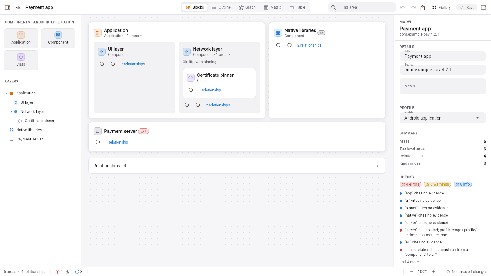
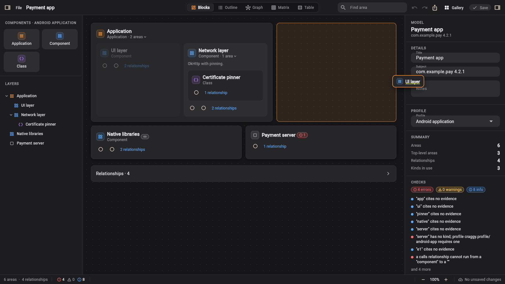
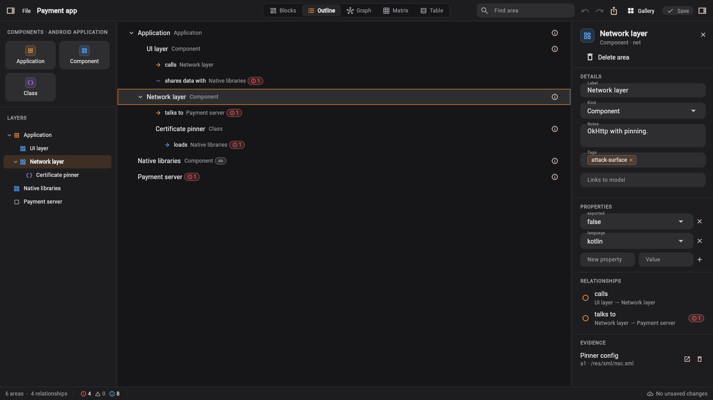
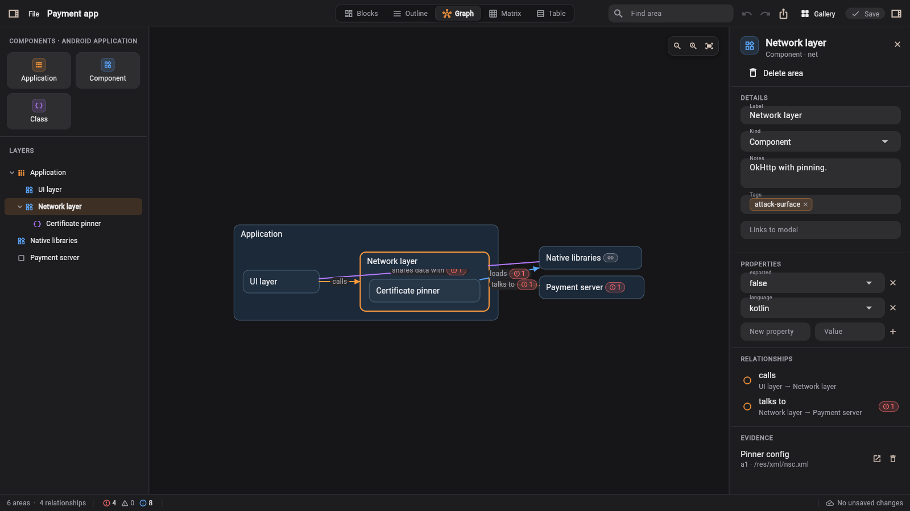
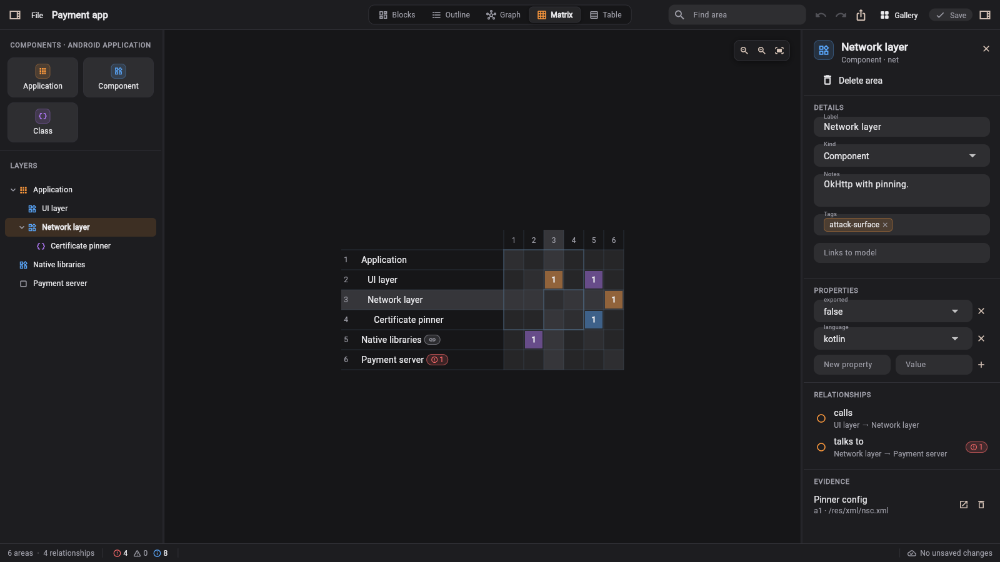
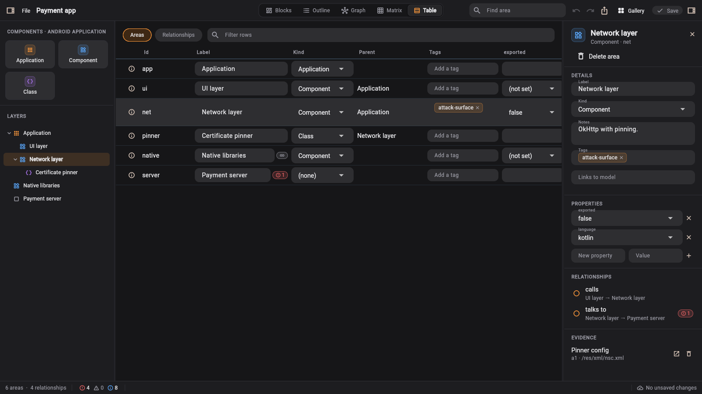

<picture>
  <source media="(prefers-color-scheme: dark)" srcset="docs/assets/craggy-wordmark-on-dark.svg">
  
</picture>

# Modelling Services

Block models as data: labelled areas nested by containment, labelled relationships between them,
typed properties, cited evidence and saved views, in one versioned JSON format. Go and Dart
implement the same format and engines, proven equal by shared conformance vectors, and a Flutter
package renders and edits models on desktop and the web.

<picture>
  <source media="(prefers-color-scheme: dark)" srcset="docs/assets/screenshots/editor-dark.png">
  
</picture>

## The modeller

`apps/modeller` is a standalone editor for Windows and the web, built on the `ModelEditor` widget
that any Flutter host can embed.

- **Palette and layers.** Drag a component onto the board or onto an area to add it inside. The
  Layers tree mirrors containment and reparents by drag.
- **A fixed grid, not a free canvas.** Areas sit on a 10-column grid inside their parent. Resize
  from an edge or corner in 10% steps of the parent's width and in fixed rows. Sizes are saved in
  the view, not in the model.
- **Drag to rearrange.** Drag a card from anywhere on it. A placeholder shows where it will land
  and the other cards make room. Drop on an edge to place it beside a card, or on the middle to
  put it inside.
- **Inspector and checks.** The docked inspector edits label, kind, notes, tags, typed properties,
  relationships and evidence. Lint findings from the profile show on the cards and in the status
  bar. Every edit is undoable.



The same model and selection carry across five views:

| Outline | Graph |
| --- | --- |
|  |  |
| **Matrix** | **Table** |
|  |  |

Run it locally:

```bash
cd apps/modeller && flutter run -d chrome     # or -d windows
```

## For agents

Point an agent at the hosted MCP server and it can sketch, edit, check and export models, then
hand you a link that opens the result in the modeller. Nothing is stored and there are no accounts.

```bash
claude mcp add --transport http craggy-models https://models.craggy.io/mcp
```

Or run it locally over stdio with `go install github.com/craggy-io/modelling-services/cmd/modelling-mcp@latest`.
See [mcp](docs/mcp.md) for the tools and other clients.

## Features

- **One format** ([format](docs/format.md)): `craggy.model` version 2, with a [JSON Schema](schema/model.v2.schema.json), canonical encoding, strict decoding, bounds, and an upgrade from the version 1 graphs craggy-labs stored.
- **Small, invertible edits** ([edit](docs/edit.md)): fourteen id-addressed operations applied all or nothing; every apply returns the operations that undo it.
- **Revision diffs** ([diff](docs/diff.md)): nodes and edges added, removed or changed, with each field's old and new value.
- **Queries and lint** ([query](docs/query.md)): search, neighbours, paths, impact, and lint rules, including checks against an optional profile (node and edge kinds, containment rules, typed properties).
- **Import and export** ([export](docs/export.md)): Mermaid and Markdown outline both ways (byte-identical in Go and Dart), CSV both ways, Graphviz DOT and static SVG out.
- **Capabilities** ([modelcap](docs/modelcap.md)): `<prefix>.list/read/create/update/apply/attach/diff/lint/query/export` over a storage port the host implements, and stateless tools over documents the caller holds.
- **MCP server** ([mcp](docs/mcp.md)): `cmd/modelling-mcp` serves the stateless tools over stdio or streamable HTTP, hosted at `https://models.craggy.io/mcp`.
- **Bundle kinds** (`kinds`): ship profiles (`craggy.model-profile@1`) and template models (`craggy.model@1`) as foundation-kit bundle content.
- **Dart and Flutter** ([flutter](docs/flutter.md)): `clients/dart/modelling` (pure Dart: format, engines, edit history) and `clients/flutter/modelling_flutter` (controller, renderers, editor, theme, file sources), plus the standalone `apps/modeller`.

## Layout

| Path | What |
| --- | --- |
| `model` | Types, codec, validation, index, profiles |
| `diff`, `edit`, `query`, `export` | Engines over `model` |
| `modelcap` | capability-services registrations over a `Store` |
| `kinds` | foundation-kit bundle kinds and compilers |
| `cmd/modelling-mcp` | The MCP server (stdio and HTTP) and its container image |
| `schema/` | JSON Schemas: model v2, model v1 (read only), profile v1 |
| `conformance/` | Shared vectors; Go runs them in `conformance/`, Dart in `clients/dart/modelling/test` |
| `clients/dart/modelling` | The Dart twin of the Go engines |
| `clients/flutter/modelling_flutter` | Flutter renderers and editor |
| `apps/modeller` | Standalone Flutter app (desktop and web) |

## Quick start (Go)

```go
m, err := model.Decode(raw)                 // v1 graphs are upgraded
if err := m.Validate(model.Limits{}); err != nil { … }
next, undo, err := edit.Apply(m, []edit.Op{
    {Op: edit.NodeAdd, Node: &model.Node{ID: "db", Label: "Database"}},
}, model.Limits{})
changes := diff.Compare(m, next, diff.Options{})
fmt.Print(export.Outline(next))
```

## Checks

```bash
go vet ./... && go test ./...                         # Go, including the conformance vectors and schemas
(cd clients/dart/modelling && dart analyze && dart test)
(cd clients/flutter/modelling_flutter && flutter analyze && flutter test)
(cd apps/modeller && flutter analyze && flutter test)
```

Read [AGENTS.md](AGENTS.md) before changing anything.
